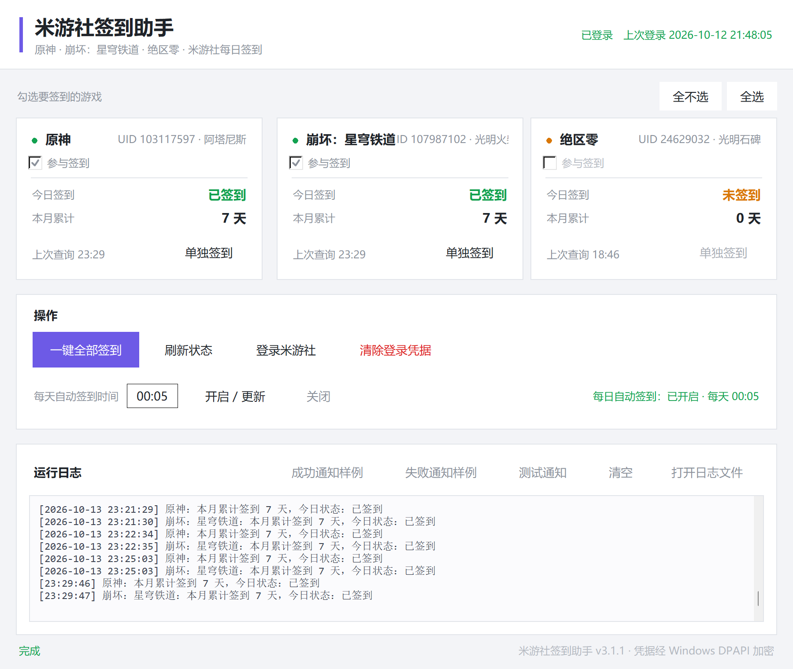

# 米游社签到助手

> **v3.2.0** · [更新日志](#更新日志) · **代码、文档与图标均由 AI 生成（vibe coding）**

原神 / 崩坏：星穹铁道 / 绝区零 每日自动签到，带图形界面。**不用开游戏**，
登录一次后可以一键把勾选的游戏一起签了，也可以交给 Windows 计划任务
每天在后台静默完成，奖励直接进游戏邮箱。



---

## 特性

- **三款游戏** —— 原神、崩坏：星穹铁道、绝区零，想签哪个勾哪个
- **免手动抓 cookie** —— 内嵌拉起系统 Edge 完成登录，从浏览器引擎层读 cookie（含 HttpOnly），不用去 F12 里翻
- **凭据本地加密** —— Windows DPAPI 加密，只有当前 Windows 用户能解密
- **定时签到** —— 一键注册 Windows 计划任务，`pythonw.exe` 后台执行不弹黑窗；错过触发点（关机 / 睡眠）后开机自动补跑
- **签到即提醒** —— 每次签到（手动 / 自动）后右下角弹真正的 Windows 通知：签上了、早就签过了、哪个游戏失败了，一目了然；不想被成功消息打扰的话，关掉「签到成功后也弹通知」即可（失败通知照常）
- **免安装便携版** —— 不用装 Python，解压双击即用
- **检查更新** —— 右下角一键查 GitHub 最新版本（启动时也会静默查一次），有新版本直接跳发布页；查不到就悄悄算了，不打扰
- **高分屏适配** —— 声明 DPI 感知 + 按真实缩放渲染，4K 屏字体不糊

---

## 快速开始

### 便携版（推荐，不想装 Python 就选这个）

到 [Releases](https://github.com/mxf133/mys-signin-helper/releases/latest) 下载
**`mys-signin-helper-vX.Y.Z-portable.zip`**，解压后双击 **`米游社签到助手.exe`**。

- 免安装、免配环境，解压到桌面或 D 盘都能跑
- **别放进 `C:\Program Files`** 这类受保护目录，否则凭据和日志写不进去
- 出问题双击 **`自检.bat`**，会生成并打开「自检报告.txt」

### 源码版

```bat
git clone https://github.com/mxf133/mys-signin-helper.git
cd mys-signin-helper
安装依赖.bat                  :: 自动创建 .venv 并装依赖（需 Python 3.10+）
启动米游社签到助手.bat         :: 打开界面
```

也可以点右上角 **Code → Download ZIP**，解压后同样双击这两个 bat。

---

## 使用

| 步骤 | 操作 |
| --- | --- |
| 1 | 打开程序，点 **【登录米游社】**，在弹出的 Edge 窗口里正常登录 |
| 2 | 在卡片上勾选要签到的游戏（默认全选），点 **【一键全部签到】** 验证一次 |
| 3 | 想每天自动签到：填好时间（默认 `09:05`）后点 **【开启 / 更新】** |

之后每天到点由计划任务在后台把勾选中的游戏签一遍。

> **关于「开机自动签到」**：点【开启 / 更新】时，程序会**依次尝试**几条路，
> 哪条能成就用哪条，用户不用关心区别：
> ① 系统计划任务（`schtasks`，主名字失败会自动换备用名字）；
> ② 交给已安装的"通知助手"（打包应用）去注册；
> ③ 注册表启动项 / 启动文件夹（登录 Windows 后自动签到一次，效果等价）。
> 全程**不调用 PowerShell**（360 会把程序拉起的 powershell.exe 误判成木马并弹窗）。
>
> 如果这些都失败（实测在装了安全软件的机器上很常见：**同一个任务 XML 交给
> PowerShell 执行能成功，交给本程序执行却被无声拒绝**——这是按"未知/未签名
> 程序"下发的策略，关掉安全软件的界面开关往往也不解除），程序会**自动请求一次
> 管理员权限**：屏幕弹出 UAC 时点【是】，计划任务就注册好了（只此一次，
> 以后更新需要再点一次）。
> 就算完全不设置也不会漏签：**打开程序时它会自动签到当天还没签的游戏**。

> **每次签到后都会弹真正的 Windows 系统通知**（右下角那种，会留在通知中心，
> 带本程序的名字和图标），而不是程序内弹窗 —— 签上了、早就签过了、哪个游戏
> 失败了，一眼就知道；自动签到失败时，你下次开电脑就能立刻看到
> "cookie 过期，请重新登录"。
>
> 想先确认通知能不能弹，任选一种：
> ① 双击本目录下的 **`测试系统通知.bat`**；
> ② 在程序里点【测试通知】（运行日志那一栏右上角）；
> ③ 命令行 `python cli.py doctor --notify`（便携版：`米游社签到助手.exe doctor --notify`）。
>
> 想看看**签到成功后通知的具体内容**，点运行日志栏右上角的
> 【成功通知样例】/【失败通知样例】——用假数据弹一条样例，不会真的去签到。
>
> **它是怎么做到的**：WinRT 的系统通知只允许"已安装应用"（带程序包标识）的
> 进程调用，纯源码运行的 Python 会报 `0x80073D54`。所以随程序安装了一个极小的
> 通知助手（MSIX 松散布局包 + 应用执行别名 `miyoushe-toast.exe`），主程序调用
> 这个别名，助手就以已安装应用的身份发通知。相关文件：
>
> - 构建/注册/卸载：`python build_toast_package.py`
>   （`--check` 看状态，`--uninstall` 卸载；注册需要 Windows 开发者模式）
> - 助手源码：`toast_helper.py`；打包产物：`.toast_pkg/`
> - 卸载也可以直接去「设置 → 应用 → 已安装的应用」里卸载"米游社签到助手"
>
> 万一助手不可用（没装/被拦），程序会**依次退到**托盘气泡通知、再退到自绘的
> 右下角卡片，绝不会因此漏掉提醒，也不会弹模态窗口打断你。
>
> **便携版也带助手**（打包时随程序放在 `通知助手\` 目录里）。第一次点
> 【测试通知】时，程序会自动启用它：弹一次管理员权限（UAC），点【是】即可。
> 这一步只做两件事 —— 必要时打开 Windows「开发者模式」（免签名注册应用的前提，
> 可随时关掉），以及把助手注册成已安装应用（文件放在
> `%LOCALAPPDATA%\MiyousheSignInAssistant`）。想撤销：上面那条卸载命令，
> 或在「设置 → 应用」里卸载"米游社签到助手"。命令行等价操作：
> `米游社签到助手.exe notify-setup`（源码版：`python cli.py notify-setup`）。

> **关于【登录米游社】**：每次点它都会先退出浏览器里旧的米游社登录状态
> （只清登录 cookie，保留设备指纹），再让你重新登录。这样才换得了账号，
> 也才拿得到米哈游新下发的、能用于签到的凭据。
> 登录完程序会真的校验一次会话：校验通过才提示"签到凭据校验通过"；
> 若右上角显示"已登录 · 签到凭据不完整"，说明这次没拿到 `cookie_token`，
> 换一种登录方式（短信验证码 / 账号密码）再登录一次即可。

> **签到失败会自动问你要不要重新登录**：一旦签到（或刷新状态）发现凭据失效、
> 缺 `cookie_token`，程序会弹窗询问"现在重新登录米游社吗？"，点【是】就直接
> 拉起登录窗口，**登录成功后自动补签一次**。开机后的后台刷新只在"凭据已失效"
> 时提醒，且每次运行只提醒一次，不会反复弹窗。

**【清除登录凭据】** 等于退出登录：既删掉本机的 `cookie.enc`，也会退出
浏览器里保存的米游社登录态，之后可以换成别的账号重新登录。

**命令行**（便携版把 `python cli.py` 换成 exe 本身）：

```bat
python cli.py login                            :: 登录一次
python cli.py sign                             :: 签到界面上勾选的游戏
python cli.py sign --game genshin --game zzz   :: 只签指定游戏（可重复传）
python cli.py status                           :: 查询状态
python cli.py task / untask                    :: 注册 / 删除计划任务
python cli.py doctor                           :: 环境自检
```

`--game` 取值：`all`、`genshin`、`starrail`、`zzz`；不传则跟随界面勾选。

---

## 环境要求

| 项目 | 源码版 | 便携版 |
| --- | --- | --- |
| 操作系统 | Windows 10 / 11 | 同左 |
| Python | **3.10+** | **不需要**（已内置） |
| 浏览器 | Microsoft Edge（系统自带） | 同左 |
| 账号 | 米游社账号，且账号下有对应游戏的角色 | 同左 |

> 只支持国服。国际服 HoYoLAB 需要另一套凭据，暂未适配。

---

## 常见问题

**Q：自动签到时间点电脑没开机 / 在睡眠，会漏签吗？**
不会。任务带「错过后尽快启动」设置，当天内只要开机联网就会自动补跑；
断电好几天也只补最近一次。用电池也会执行。唯一补不回来的是「错过的那一天」
本身 —— 米游社按自然日发奖，跨天就没了。

**Q：提示"cookie 已失效"？**
cookie 有效期约一个月（其中用于游戏签到的 `cookie_token` 会话往往更短）。
重新点一次【登录米游社】即可，这是唯一的日常维护点。
如果重新登录后仍失败，看右上角状态：出现"签到凭据不完整"就再登录一次，
并在浏览器里换一种登录方式（短信验证码 / 账号密码）。

**Q：想换一个米游社账号？**
先点【清除登录凭据】（会把浏览器里的米游社登录态一起退掉），再点
【登录米游社】用另一个账号登录。

**Q：点【开启 / 更新】时弹出了 UAC（管理员权限请求）？**
这是**正常流程，不是出错**。实测有些安全软件会按"未知 / 未签名程序"直接拒绝本程序
写启动项和计划任务（同一个任务 XML 交给 PowerShell 执行却能成功），而且关掉它的
界面开关也未必解除。所以程序会**自动请求一次管理员权限**：在 UAC 窗口点【是】就
注册好了（以后更新设置时需要再点一次）。
想彻底免掉这一步：把本程序（源码版还要加上 `.venv\Scripts\pythonw.exe`）加进安全
软件的**信任区**，之后普通权限就能直接注册。
不设置也不影响：打开程序时它会自动签到当天没签的游戏，所以不会漏签。

**Q：签到后会怎么提醒我？**
每次签到（手动或自动）结束后，右下角都会弹一条真正的 Windows 系统通知
（带程序名和图标，会留在通知中心）：成功会列出各游戏拿到的奖励和本月累计
天数，失败会写明是哪个游戏、以及是不是 cookie 过期需要重新登录。
程序内不再弹窗打断你——通知中心里那条就是入口。
不想被"签到成功"打扰的话，取消「操作」区里的 **【签到成功后也弹通知】**
勾选即可：之后只在失败 / 需要重新登录时提醒（该设置同时作用于计划任务）。
若连通知也弹不出来（同样可能被安全软件拦），可以看 `signin.log` 或程序里的运行日志。

**Q：某个游戏显示"签到失败"？**
先点【刷新状态】看卡片上有没有 UID —— 没有 UID 说明该账号在这款游戏下没有角色。

**Q：提示需要人机验证？**
米哈游小概率触发 Geetest，脚本无法通过。手动去米游社 App 签一次，第二天通常恢复。

**Q：怎么确认「每日自动签到」真的生效了？**
别只看"已开启"三个字。界面「每天自动签到时间」右边那行提示才是关键：
正常时显示"已开启 · 每天 00:05"；如果变红写着"上次自动签到失败：…"，
点一次【开启 / 更新】重建任务即可。也可以跑 `python cli.py doctor`
（便携版双击 `自检.bat`），报告里会列出**上次运行结果**——`0x0` 才算真的跑成功。

**Q：按钮点了没反应 / 想知道哪一步坏了？**
跑自检：源码版 `python cli.py doctor`，便携版双击 `自检.bat`。

**Q：便携版启动慢 / 杀毒报毒？**
首次启动要解压上百 MB，稍慢正常。PyInstaller 的包偶尔被误报（自解压行为模式），
加白名单即可；介意就用源码版。

---

## 更新日志

### v3.2.0

**修复：自动签到可能一次都没跑成功（上次结果 `0x800702E4` / 错误 740）。**

- 计划任务原来固定按「最少权限」注册。如果程序 exe 被勾过
  **「以管理员身份运行」**（属性 → 兼容性），或凭据文件只有管理员读得到，
  任务每次触发都会被系统当场拒绝——进程连一行日志都写不出来，
  而界面上仍然显示"已开启"，完全看不出问题。
- 现在注册前会先探测两件事：exe 是否带 `RUNASADMIN` 兼容性标记、
  `cookie.enc` / `settings.json` 当前用户读不读得到。需要提权时直接把任务
  建成 **「使用最高权限运行」**，之后每次触发都不弹 UAC，也不会 740。
- 自动签到的状态不再只看"任务在不在"：界面会读计划的**上次运行结果**，
  失败时直接标红说明原因（例："需要管理员权限，点「开启 / 更新」修复"），
  `自检报告.txt` 里也会列出上次结果。只有 `0x0` 才是真的跑成功了。

**新：检查更新。**

- 右下角新增淡色 **「检查更新」** 入口；启动 3 秒后也会静默查一次，
  有新版才在状态栏提示，查不到（断网 / 被墙 / 限流）完全不打扰。
- 发现新版本时弹窗显示版本号、发布日期与更新说明，可直接打开发布页
  或下载便携版 zip。
- 查版本走 `releases/latest` 的网页跳转（不受 GitHub API 限流影响），
  发布说明才用 API 补，API 失败不影响"有没有新版本"这个结论。
- 版本号统一由 `core.VERSION` 提供（界面、检查更新、打包脚本共用），
  不再分散在多处。
- 命令行也能查：`python cli.py update`。

### v3.1.3

**修复：开启自动签到时程序崩溃（`PermissionError`）。**

- 通知助手（`toast_helper.exe`）在注册计划任务时需要写一个临时 XML 文件，
  原来先试 `%TEMP%`、失败后回退到脚本所在目录，但回退路径**没有异常处理**——
  以 MSIX 已安装应用身份运行时两个目录都可能不可写，未捕获的 `PermissionError`
  直接崩溃整个进程
- 现在回退路径也加了 `try/except`，两个位置都写不了时优雅降级：跳过计划任务，
  继续尝试注册表启动项和启动文件夹，不再崩溃

### v3.1.2

**新：可以关掉"签到成功"通知了**（「操作」区新增【签到成功后也弹通知】勾选框，默认开）。

- 适合不想每天被"签到成功"打扰的用户：取消勾选后，只在**失败 / 需要重新登录**时提醒
- 该设置同时作用于计划任务的每日自动签到，存进 `settings.json`，重启后保留
- 【成功通知样例】按钮不受影响——关掉通知的用户仍然可以主动预览它长什么样
- 旧版升级上来自动是"开"，行为不变

### v3.1.1

**新：【成功通知样例】/【失败通知样例】按钮**（运行日志栏右上角，挨着【测试通知】）。

- 一键预览"签到成功"和"签到失败"两种通知的具体内容，用的是与真实结果
  同构的假数据，**不会真的去签到**
- 【测试通知】验证"通知能不能弹出来"，样例按钮验证"签完弹的内容对不对"
- 界面截图同步更新到当前版本

### v3.1.0

**新：每次签到后都弹 Windows 通知（成功也弹）。**

- 以前只有签到**失败**才提醒，成功时悄无声息；现在手动签到、开机自动签到、
  计划任务签到，**每次结束后都会弹一条系统通知**：各游戏分别显示
  "签到成功，获得 ××"、"今天已经签到过了"或"失败 / 需要重新登录"，
  并按来源标注（手动签到 / 手动刷新 / 开机自动签到 / 每日自动签到 /
  登录后自动补签）。
- 通知里附带"本月累计签到 X 天"，不打开程序也知道进度。
- 纯状态查询（【刷新状态】时当天都已签过）不会弹，避免每次刷新都打扰。
- 失败提醒保留原来的 10 分钟节流；成功提醒不节流——每次签到都该有反馈。

### v3.0.1

**修复：便携版没有"通知助手"，只能退到自绘卡片。**

- 便携版打包时**带上通知助手**（放在 `通知助手\` 目录里）。第一次点
  【测试通知】会自动启用它：弹一次管理员权限（UAC）点【是】即可。
- 助手现在能**自己注册自己**：用 WinRT 的 `PackageManager` 直接注册松散布局
  （`--register-self`），不再需要 PowerShell / `Add-AppxPackage`——既避开
  360 把 `powershell.exe` 判成木马的问题，也让便携版（没有 Python 环境、
  跑不了构建脚本）能一条命令搞定：`米游社签到助手.exe notify-setup`。
- 助手不再依赖"程序目录位置稳定"：注册前会把自己复制到
  `%LOCALAPPDATA%\MiyousheSignInAssistant\pkg`，便携版文件夹之后随便搬动、删除
  都不影响已注册的通知能力。
- **助手体积 49.6 MB → 36.1 MB**：PyInstaller 会把 winrt 里 78 个命名空间全打包，
  现在按"真实导入闭包 + 惰性依赖分组"裁剪到 37 个（winrt 部分 28.9 MB → 15.1 MB），
  并加了「注册 API 探针」自检（用假清单真调一次注册，缺模块会立刻暴露），
  裁剪后自检不过就自动还原。
- 顺带修掉两个会静默失败的坑：`PackageManager` 没有 `find_packages_by_name`
  （正确方法是 `find_packages_by_name_publisher`），以及非提权下列表接口会被
  系统拒绝（现在会优雅降级，不再当成"没装"）。

### v3.0.0

这一版把「提醒」和「自动签到」两件事彻底做通，并修掉一批让人误判的假状态。
（v2.2.3 的修复也一并包含在这一版里。）

**修复：签到一直失败（接口返回 -100「请登录后重试」）**

- 原因是登录流程直接复用浏览器里已有的旧会话，几秒就"登录成功"；但米哈游把会话
  分成两套：社区接口认 `ltoken`，**游戏签到接口认 `cookie_token`**，旧会话的
  `cookie_token` 早就失效了——于是程序一直显示已登录、签到却始终失败。
- 现在登录后会用米游社账号接口真的校验一次，只有 `cookie_token` 会话有效才提示
  "签到凭据校验通过"；界面右上角也会显示"已登录 · 签到凭据不完整"，避免假成功。

**修复：无法更换 cookie / 无法退出登录**

- 点【登录米游社】会先退出浏览器里旧的米游社登录态（只清登录 cookie，保留设备
  指纹），所以每次都是真正的重新登录，可以换账号；【清除登录凭据】同样会退出
  浏览器登录态。

**新：签到失败弹真正的 Windows 系统通知**

- 右下角 + 通知中心，带程序名和图标，不再是程序内弹窗；自动签到失败时你下次
  开电脑就能看到"cookie 过期，请重新登录"。
- 实现：WinRT 通知只允许"有程序包标识（已安装应用）"的进程调用，纯源码运行的
  Python 会报 `0x80073D54`。因此随程序安装了一个极小的**通知助手**
  （MSIX 松散布局包 + 应用执行别名 `miyoushe-toast.exe`）：主程序调用这个别名，
  助手就以"已安装应用"身份发通知。构建 / 升级 / 卸载见 `build_toast_package.py`
  （注册需要 Windows 开发者模式）。
- 助手不可用时依次退回托盘气泡、自绘右下角卡片（已做 DPI 感知，200% 缩放下
  也清晰），绝不会漏掉提醒，也不会弹模态窗口打断你。
- 全程**不调用 PowerShell**：实测 360 会把本程序拉起的 `powershell.exe` 判成
  `Trojan.Generic` 直接结束进程并弹"木马查杀"警报。

**修复：【开启 / 更新】在装了安全软件的机器上必定失败**

- 实测同一个任务 XML，交给 PowerShell 执行能成功、交给本程序（以及它拉起的任何
  子进程，包括打包成 exe 的助手）却被无声拒绝——注册表启动项、启动文件夹同样如此。
  这是按"未知 / 未签名程序"下发的驱动级策略，关掉安全软件的界面开关往往不解除。
- 现在点【开启 / 更新】会**依次尝试**：普通权限计划任务 → 已安装的助手代注册 →
  **自动请求一次管理员权限**（弹出 UAC 时点【是】即可）。注册结果由子进程落盘
  回传，父进程不再误判；普通权限"查不到"管理员建的任务时以设置里记录的模式为准，
  状态显示不再出错。【关闭】同理。
- 顺带修掉一个崩溃：状态栏取"提示第一行"的辅助函数在提示为空时会 `IndexError`
  （界面日志里的 `[界面] 界面处理结果时出错`）。

**其他修复与改进**

- **打开程序即签到**：启动时若当天还有游戏没签就直接签掉，没设置自动签到也不漏签。
- **修复：点【登录米游社】起不来浏览器**。Playwright 的 Node 驱动按系统 `%TEMP%`
  建临时目录，临时目录不可写时会报 `EPERM ... mkdtemp`，窗口根本打不开。现在固定
  使用程序目录下的 `.pw_tmp`（`doctor` 自检走同一套逻辑）。
- **修复：界面会永久卡在"执行中…"**。消息循环原来没有兜底，处理结果时一旦抛异常
  就再也不会被调度、按钮永久变灰。现在异常会被捕获并写进日志，后台线程任何异常
  都会变回结果，并加了看门狗——操作超时自动恢复按钮。
- **【开启 / 更新】改为多策略自动降级**，且注册后会复核是否真的生效，不再假成功。
- 新增【测试通知】按钮与 `测试系统通知.bat`，一键验证通知能不能弹出来。

### v2.2.2

**修复：图标在小尺寸下显示成一片破碎的色块。** `icon.ico` 里 16/24/32/48/64
五个位图帧的 `BITMAPINFOHEADER` 把 `biHeight` 写成了图像高度（ICO 规范要求写
**2 倍**：上半彩色位图 + 下半 AND 掩码），而且完全没有 AND 掩码。
Windows 的图标加载器固定按 `biHeight / 2` 解析，这几个档就被解成了半高，
渲染出来是乱码色块——桌面快捷方式和资源管理器里看到的都是这个样子。
只有 128/256 两个 PNG 档正常。现在按规范重新生成，尺寸档也扩到 10 档
（16/20/24/32/40/48/64/96/128 走 DIB + 256 走 PNG）。

界面与功能跟 v2.2.1 完全一致，只换了图标。

### v2.2.1

**修复：v2.2.0 里整个「操作」面板不见了。** 加游戏勾选工具条时，操作区与日志区
被放到了同一个 grid 单元格，Tk 直接叠加，后放的日志区把操作区整个盖住（功能没坏，
只是点不到）。日志区挪到下一行，并补了一组布局回归测试防止复发。

### v2.2.0

- **新增绝区零签到** —— 三款游戏齐了
- **新增"选择要签到哪几个游戏"** —— 每张卡片一个勾选框 + 全选 / 全不选；
  勾选结果本地保存，重启后保留；至少要留一款
- **命令行支持多选** —— `--game` 可重复传入

### v2.1.1

**修复：错过触发点不再漏签。** 改用 XML 注册计划任务，显式配置
「错过后尽快启动」、电池可执行，执行超时从 72 小时收紧到 1 小时。

### v2.1.0

**新增免安装便携版** + **环境自检 `doctor`**。

### v2.0

首个公开版本：原神 + 崩铁一键签到、Edge 内嵌登录、DPAPI 凭据加密、
计划任务定时签到、4K 高分屏适配。

---

## 隐私与安全

- **凭据只存本机** —— cookie 经 Windows DPAPI 加密写入 `cookie.enc`，
  只有当前 Windows 用户能解密，不上传任何第三方服务器
- **仓库不含凭据** —— `.gitignore` 已排除 `cookie.enc`、`.edge_profile/`、
  `signin.log`、`state.json`、`settings.json`
- **不碰游戏** —— 只调用米游社官方签到接口，不修改游戏文件、不注入进程

---

## 免责声明

本工具仅供学习与个人使用，自动化签到在理论上属于用户协议的灰色地带，
**请仅用于你自己的单个账号，不要用于多账号或高频请求**。
使用产生的任何后果由使用者自行承担。

---

## 关于本项目

本项目是一次 **vibe coding**（AI 结对编程）实践：**代码、文档、图标、打包脚本
全部由 AI 生成**，维护者只负责提需求与测试验收。仓库里的每个版本、每次 bug 修复
（包括 v2.2.1 那个「操作面板消失」的布局 bug 及其回归测试）都是在与 AI 的对话中完成的。

| 角色 | 职责 |
| --- | --- |
| **WorkBuddy** | 运行环境与工具能力：文件读写、命令执行、图像处理、包管理、版本控制 |
| **DeepSeek V4.1 Flash** | 需求分析、架构设计、代码编写、问题排查、文档撰写 |

覆盖内容：米游社接口调研与 `genshin.py` 选型、DPAPI 凭据加密、Playwright 内嵌登录、
多游戏 `GAMES` 注册表重构、4K 高分屏 DPI 修复、银狼图标裁切与 7 档 ICO 打包、
PyInstaller 便携版打包与 `doctor` 自检、计划任务 XML 注册改造。

> AI 生成的代码**不保证绝对正确**，请自行审阅后使用。

仓库地址：<https://github.com/mxf133/mys-signin-helper>

---

## License

[MIT](LICENSE)
